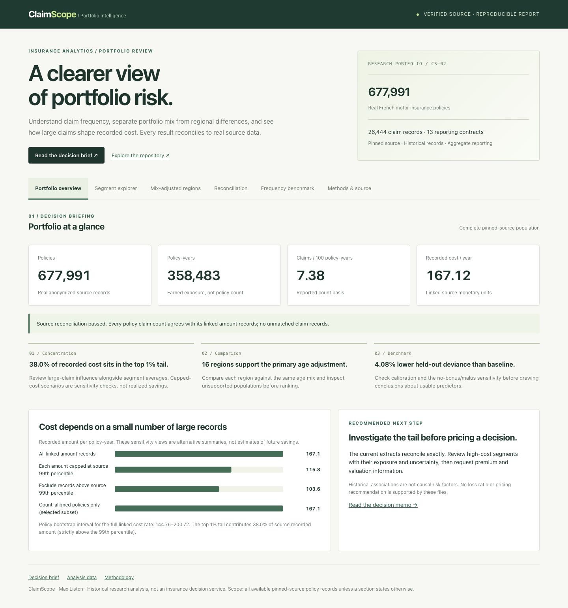

# ClaimScope — insurance portfolio intelligence

An auditable reporting system for real French motor insurance data. ClaimScope separates claim frequency, portfolio mix, and large-loss concentration, with reconciled SQL reporting and explicit uncertainty.

**Python · SQL · DuckDB · statistical uncertainty · business intelligence**

[Dashboard](https://maxliston.github.io/claimscope-insurance-analytics/) · [Decision memo](reports/EXECUTIVE_MEMO.md) · [Metric definitions](docs/METHODOLOGY.md) · [Source fingerprints](data/sources.json)



[](https://github.com/MaxListon/claimscope-insurance-analytics/actions/workflows/checks.yml)

## Evidence at a glance

- **677,991 policies / 358,482.84 policy-years**, with 26,444 claim records and exact policy-level count reconciliation.
- **38.0% of source cost** sits strictly above the 99th claim-amount percentile; the largest record alone contributes 6.80%.
- **16 of 22 regions** support primary age standardization, covering 97.4% of portfolio exposure.
- **4.08% lower held-out deviance** than a constant-rate baseline (95% paired bootstrap interval: 3.63%–4.48%). Removing bonus/malus leaves 1.63% improvement.

The [decision brief](reports/EXECUTIVE_MEMO.md) explains the implications and limitations. These historical findings support investigation, not realized savings or future-year performance claims.

## The decision
Which portfolio segments warrant investigation, and can the underlying figures be trusted? The deliverable is a review shortlist and a reconciliation report, not a pricing engine. The output helps prioritize data review and segment investigation; it does not quote insurance premiums.

## What is built
- Two pinned original CASdatasets R data files, read directly in Python. No R installation is needed.
- SQL marts that aggregate claims before joining policies, preserve zero-claim policies, and retain unmatched records for reconciliation.
- Six segmentation dimensions, frequency intervals, policy-level cost bootstrap, and large-claim influence diagnostics.
- Direct age-standardized regional comparisons with common exposure weights, explicit population-support rules, and 50/100/250-policy-year sensitivity views.
- A regularized Poisson frequency benchmark with deterministic policy-level train / validation / test partitions and exposure-weighted evaluation, paired uncertainty, and a frozen no-bonus/malus sensitivity model.
- An offline interactive dashboard with segment filters, metric switching, CSV export, reconciliation and calibration views.
- Blocking input and reporting contracts, integrity fingerprints, staged report generation, a single-writer lock, regression tests, and GitHub Actions.

## Reproduce
Python 3.12 or newer. From this repository:

```sh
python3 -m venv .venv
source .venv/bin/activate
python -m pip install -r requirements-lock.txt
python -m pip install -e '.[dev]'
python -m claimscope.pipeline
python -m pytest -q
python -m http.server 8080 --bind 127.0.0.1
```

Open `http://127.0.0.1:8080/docs/`. The first build downloads about 10 MB of original source data and verifies SHA-256 checksums. Later builds reuse verified files; `python -m claimscope.pipeline --offline` refuses network access and requires the cache. The R parser may make the first stage take a minute or more. The data warehouse is `data/warehouse.duckdb` and is excluded from Git.

For Windows, activate `.venv\Scripts\Activate.ps1` in PowerShell instead of the `source` command. To view without Python, open `docs/index.html`; the committed dashboard includes its aggregate data and needs no third-party assets.

## Read the result
Start with the [generated executive memo](reports/EXECUTIVE_MEMO.md). Numbers are generated from the pinned source, not manually inserted. The [analysis JSON](reports/analysis.json) carries totals, exceptions, intervals, model selection scores, and calibration.

The source has reported claim counts and a separate amount extract. In this pinned revision, every policy count agrees with its amount-record count and there are no orphan records. The pipeline tests deliberately cover discrepancies as well as this clean source. Frequency uses reported counts. Amount metrics use the matched amount records. Claim records with no matching policy are disclosed and excluded from segment cost rates. The dashboard never silently forces the two counts to agree.

## Architecture
```text
Pinned .rda sources → SHA-256 verification → input contracts
  → DuckDB policy / claim tables → aggregate-before-join SQL mart
  → reconciliation + segment reporting
  → statistical analysis + held-out Poisson benchmark
  → staged HTML / CSV / JSON / executive memo
```

[Runbook](docs/RUNBOOK.md) · [Data dictionary](docs/DATA_DICTIONARY.md) · [Six-week development scope](docs/DEVELOPMENT_SCOPE.md) · [Interview guide](docs/INTERVIEW_GUIDE.md)

## Verification

30 regression tests cover reporting grain, invalid data, missing population support, a Simpson’s-paradox counterexample, holdout isolation, and source integrity. Thirteen runtime contracts reconcile the reporting layers. Full source rebuilds run on GitHub for every push. Dashboard deployment waits for successful checks.

[Verification record](docs/VERIFICATION.md) · [Release review checklist](docs/REVIEW_CHECKLIST.md)

## Scope and attribution
Data: freMTPL2freq and freMTPL2sev in [CASdatasets](https://github.com/dutangc/CASdatasets), maintained by Christophe Dutang, Arthur Charpentier, and contributors. The upstream package declares GPL (>= 2); source versions and links are in `data/sources.json`. Dataset authorship is distinct from this repository's commit authorship. No underlying raw data are committed.

This is historical French motor insurance research data, not current customer data. There are no reliable policy dates, claim IDs, premium fields, or comprehensive valuation metadata. Some claim amounts follow IRSA-IDA settlement conventions. No loss ratio, future profitability, causal effect, or actual savings is claimed. The random policy holdout is not temporal or customer-level validation.

Project repository owner: Max Liston. Licensed under GPL-2.0-or-later; see [LICENSE](LICENSE).
